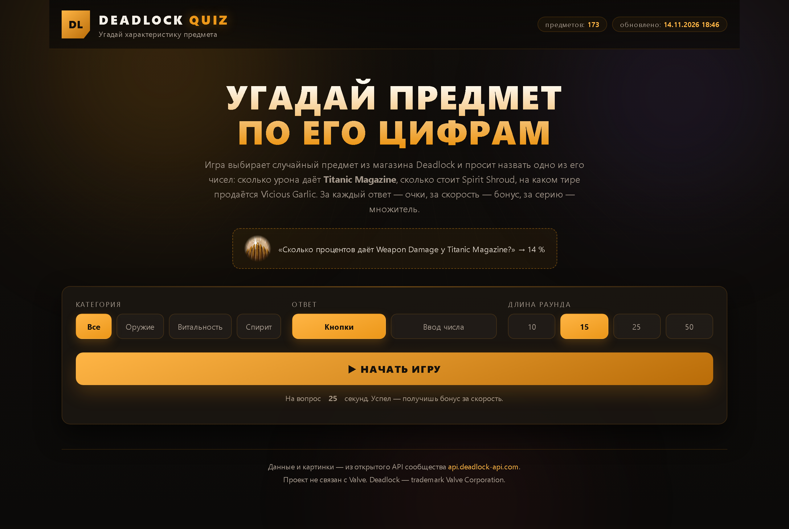
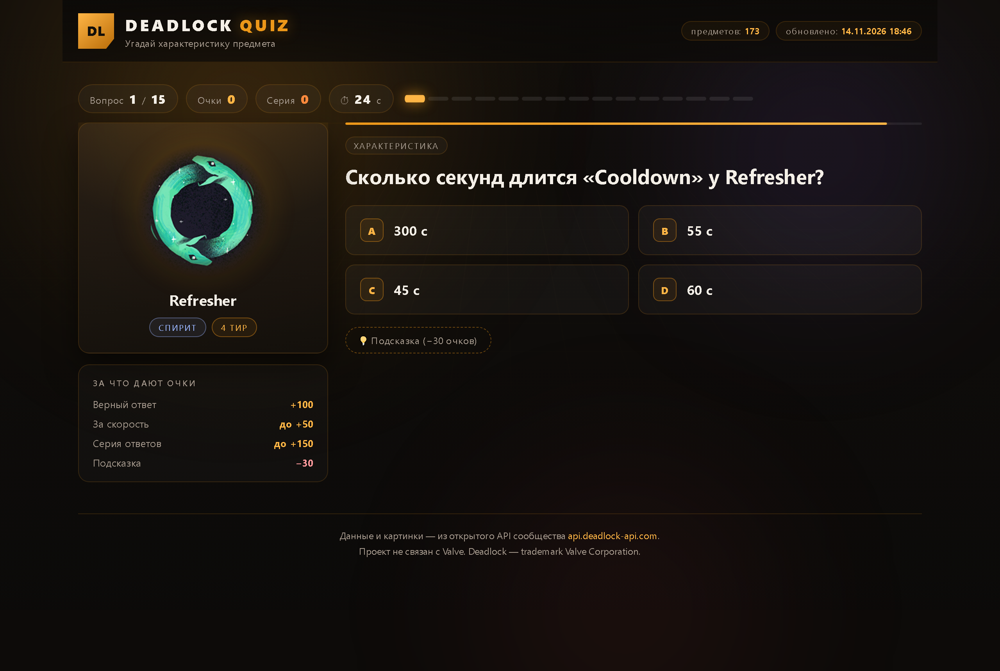
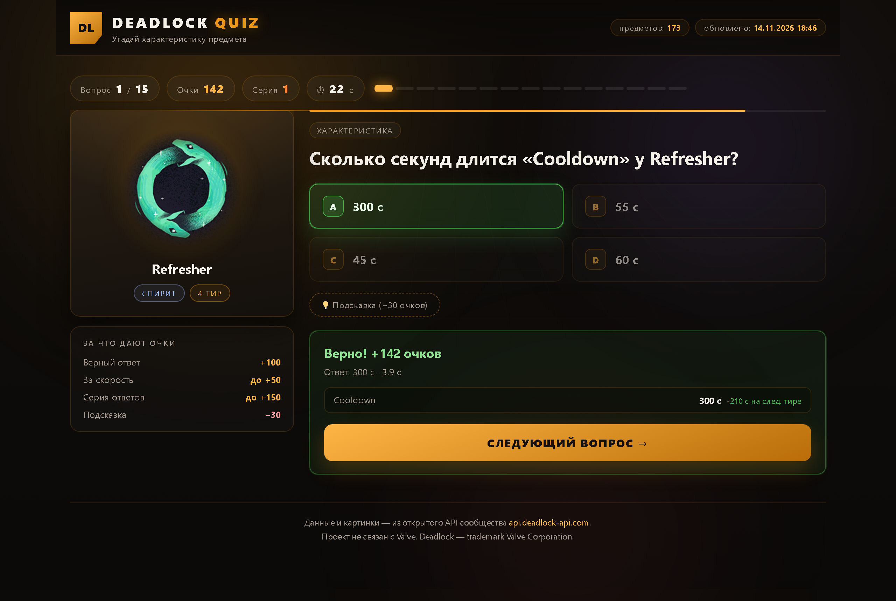
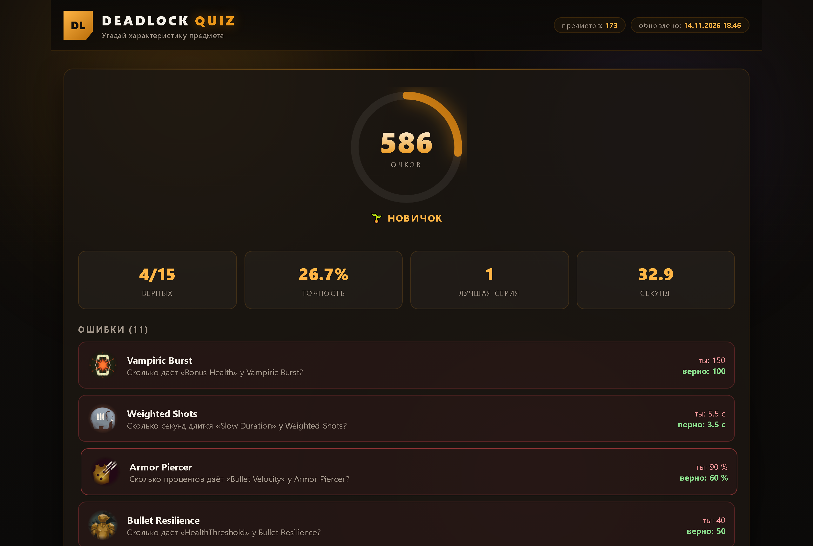

<div align="center">

# Deadlock Quiz

**Угадай предмет Deadlock по его цифрам**

<sub>«Сколько процентов даёт <b>Weapon Damage</b> у <b>Titanic Magazine</b>?» → <b>14 %</b></sub>

[](https://github.com/maxbuisness2003/deadlock_quizz/actions/workflows/ci.yml)
[](https://www.python.org/)
[](https://fastapi.tiangolo.com/)
[](https://api.deadlock-api.com)
[](#правовое-уведомление)

</div>

---

## Что это

Фанатский квиз по игре **Deadlock**: игра выбирает случайный предмет из
магазина и просит угадать одно из его чисел — сколько урона даёт
Titanic Magazine, сколько он стоит, на каком тире продаётся.

Всё построено на бесплатном открытом API сообщества
[`api.deadlock-api.com`](https://api.deadlock-api.com) — ключи не нужны.

```
Предмет из магазина Deadlock
        │  случайно
        ▼
   Вопрос про одно число  ──►  4 варианта ответа / ввод числа
        │
        ▼
  Верно → очки + бонус за скорость + серия
  Неверно → разбор: вся таблица характеристик
```

## Скриншоты

| Главная | Вопрос | Разбор ответа | Итоги |
|---|---|---|---|
|  |  |  |  |

> Скриншоты генерируются автоматически: `python scripts/screenshots.py` (нужен Playwright).

## Возможности

- **173 предмета** из живого магазина Deadlock, **726** числовых характеристик.
- **4 типа вопросов**: характеристика, прокачка до следующего тира, цена, тир магазина.
- **Два режима ответа**: кнопки или ввод числа с клавиатуры.
- **Категории**: все предметы / оружие / витальность / спирит.
- **Очки**: 100 за ответ, до 50 за скорость, до 150 за серию, −30 за подсказку.
- **Таймер** 25 секунд: полоса + счётчик секунд, краснеет на последних пяти.
- **Разбор ответа**: после ответа показывается вся таблица характеристик
  предмета, включая прирост на следующем тире — сайт не только играет, но и учит.
- **Итоги раунда**: кольцо точности, звание, лучшая серия и список ошибок с иконками.
- **Рекорд** хранится в cookie и показывается на главной.
- **Живой интерфейс**: дрейфующий фон, 3D-наклон кнопок под курсором, разлёт
  частиц за верный ответ, счётчик очков, который докручивается вверх.
- **Уважение к настройкам**: если в системе включено «уменьшить движение»,
  сайт остаётся полностью статичным. Принудительно включить или выключить
  анимации можно через `?motion=on` / `?motion=off`.
- **Работает оффлайн**: каталог лежит в SQLite, иконки кэшируются на диске.

## Быстрый старт

### Windows

```powershell
git clone https://github.com/maxbuisness2003/deadlock_quizz.git
cd deadlock_quizz

python -m venv .venv
.\.venv\Scripts\python.exe -m pip install -r requirements.txt

# обновить каталог предметов (первый раз ~2 секунды)
.\.venv\Scripts\python.exe scripts\refresh.py

.\.venv\Scripts\python.exe run.py
```

Открыть **http://127.0.0.1:8001**

> Или одной командой: `start.bat` — создаст окружение, обновит данные и запустит сайт.

### Linux / macOS

```bash
git clone https://github.com/maxbuisness2003/deadlock_quizz.git
cd deadlock_quizz

python3 -m venv .venv
source .venv/bin/activate
pip install -r requirements.txt

python scripts/refresh.py
python run.py
```

### Docker

```bash
docker compose up -d --build
# сайт на http://127.0.0.1:8001
```

## Обновление данных

Каталог предметов меняется вместе с игрой, поэтому обновляйте его регулярно:

```powershell
.\.venv\Scripts\python.exe scripts\refresh.py            # только каталог
.\.venv\Scripts\python.exe scripts\refresh.py --images   # ещё и иконки предметов
```

Сайт читает только SQLite, поэтому перезапуск не нужен — страницы сразу
показывают свежие числа. В репозитории каталог обновляется автоматически раз
в неделю ([`.github/workflows/refresh-data.yml`](.github/workflows/refresh-data.yml)).

## Как это устроено

```
app/
  main.py     FastAPI: страницы, /api/start, /api/answer, /api/hint, прокси картинок
  quiz.py     движок вопросов: что спросить и какие варианты ответа подобрать
  game.py     состояние раунда, проверка ответов, начисление очков
  ingest.py   ETL: ответ API -> нормализованный SQLite
  api.py      HTTP-клиент с дисковым кэшем ответов API
  images.py   прокси иконок с локальным кэшем
  db.py       схема SQLite и хелперы
  textutil.py мелкие помощники по тексту
  templates/  Jinja2-шаблоны (одна страница, три экрана)
  static/     CSS и JS без сборки — npm не нужен
scripts/
  refresh.py     обновление данных
  screenshots.py скриншоты для README (Playwright, опционально)
tests/           pytest: движок вопросов, игровая логика, нормализация
data/
  quiz.db        SQLite с каталогом предметов (лежит в репозитории)
  raw/           кэш ответов API (пересоздаётся)
  img_cache/     локальные копии иконок (пересоздаются)
```

### Откуда берутся вопросы

API отдаёт для каждого предмета сотни полей `properties`, где большая часть
равна нулю и в игре не показывается. Поэтому `ingest.py` берёт **только те
свойства, что реально выводятся в тултипе предмета** (`tooltip_sections`), и
оставляет только числовые с подписью и единицей измерения. Так вопрос «сколько
даёт Cooldown» никогда не спросит про поле, которого игрок в игре не видит.

Цена и тир берутся из `cost` и `item_tier`. Поле `upgrades` содержит прирост
характеристик при прокачке на следующий тир — это и есть вопросы вида «сколько
урона даст Titanic Magazine после прокачки до 3 тира» (14 % + 18 % = 32 %).

### Варианты ответа

Неправильные варианты берутся из **реальных значений того же параметра на
других предметах** — поэтому все четыре числа существуют в игре, и отличить
верное от неверного можно только знанием предмета, а не угадыванием по величине.

### Честность сервера

Браузер никогда не получает правильный ответ до того, как игрок ответил:
состояние раунда живёт на сервере, клиент получает только текст вопроса и
варианты.

## API

| Метод | Что делает |
|---|---|
| `GET /` | страница викторины |
| `POST /api/start` | начать раунд: `{slot, mode, length}` → первый вопрос |
| `POST /api/answer` | ответить: `{answer, elapsed}` → разбор + следующий вопрос |
| `GET /api/hint` | подсказка к текущему вопросу (−30 очков) |
| `GET /api/stats` | статистика базы |
| `GET /img/<path>` | прокси иконок предметов с кэшем |
| `GET /healthz` | проверка живости |

Параметры страницы: `?motion=on` — принудительно включить анимации,
`?motion=off` — выключить.

## Тесты

```powershell
.\.venv\Scripts\python.exe -m pip install -r requirements-dev.txt
.\.venv\Scripts\python.exe -m pytest -q
```

Тесты не ходят в сеть: база подставляется временная, данные — из реального
формата API.

## Участие в проекте

Присылайте идеи, баги и правки — см. [CONTRIBUTING.md](CONTRIBUTING.md).
Список изменений — в [CHANGELOG.md](CHANGELOG.md).

## Правовое уведомление

Проект **не связан с Valve** и не распространяет игровые ассеты: используются
только открытые данные из API сообщества и ссылки на иконки, которые отдаёт
CDN сообщества. Deadlock — trademark Valve Corporation.

**Лицензия не указана.** Все права защищены: код и материалы репозитория
можно свободно смотреть, но нельзя копировать, изменять и распространять без
разрешения автора.

Названия предметов и характеристик оставлены на английском (как в игре),
интерфейс — на русском.

---

<details>
<summary><b>English</b></summary>

A fan quiz for **Deadlock**: the game picks a random shop item and asks you to
guess one of its numbers — how much Weapon Damage the Titanic Magazine gives,
what it costs, which tier it belongs to.

- **173 items**, **726** numeric stats, 4 question types (stat, tier upgrade,
  price, shop tier).
- Two answer modes: multiple choice or typing a number.
- Scoring: 100 per correct answer, up to 50 for speed, up to 150 for a streak,
  −30 for a hint. 25-second timer.
- After each answer the full stat sheet of the item is shown — it teaches, not
  just tests.
- Data comes from the free community API
  [`api.deadlock-api.com`](https://api.deadlock-api.com); no API keys.
- Works offline: catalogue in SQLite, item art cached on disk.

```bash
git clone https://github.com/maxbuisness2003/deadlock_quizz.git
cd deadlock_quizz
python3 -m venv .venv && source .venv/bin/activate
pip install -r requirements.txt
python scripts/refresh.py
python run.py        # http://127.0.0.1:8001
```

Not affiliated with Valve. No license granted — all rights reserved.

</details>
